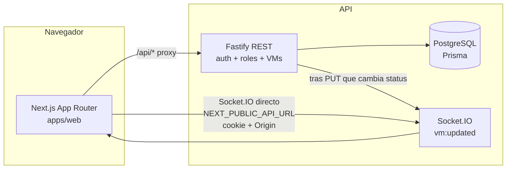
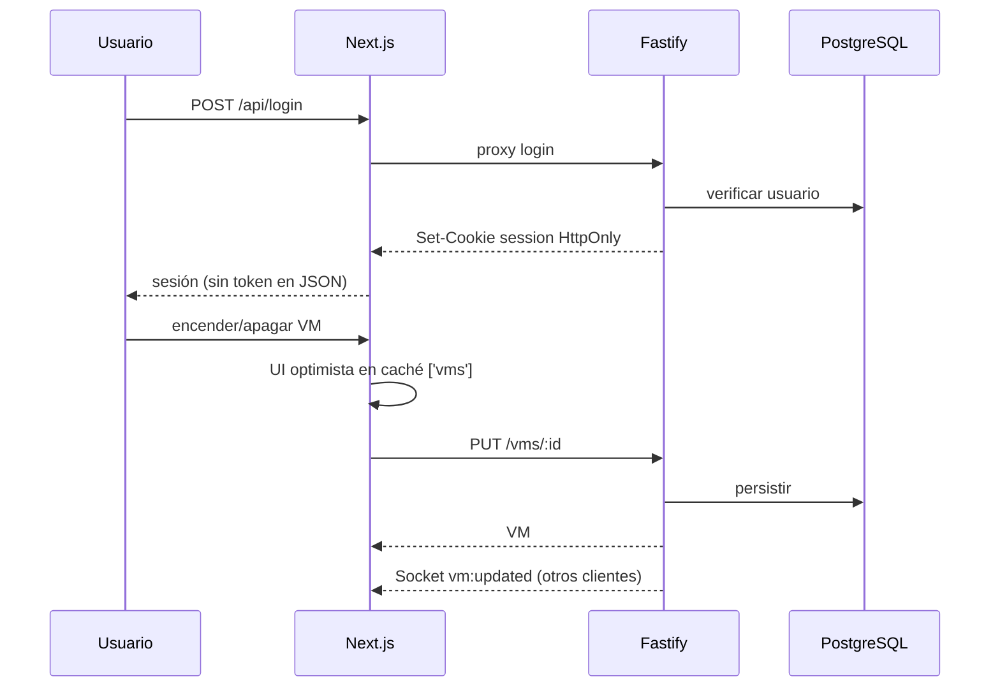

# IFX — VM Console

Prueba Full Stack **local** de gestión de máquinas virtuales: el frontend es el protagonista y la API aplica autenticación, roles y validación. Producto de demostración: **VM Console**.

Evaluación prevista en máquina local (sin despliegue en la nube).

## Requisitos previos

| Herramienta | Versión |
| --- | --- |
| Node.js | ≥ 20 (en esta entrega: 24.21.0) |
| pnpm | 10 (`packageManager`: `pnpm@10.26.2`) |
| Docker Desktop | con Compose (en esta entrega: 29.x) |

La ruta del clon puede contener espacios; los scripts usan rutas entre comillas.

**Windows:** clona en una ruta razonablemente corta (por ejemplo `C:\dev\ifx`). Si la ruta del proyecto es muy larga, la de los binarios de Prisma dentro de `node_modules` supera el límite de 260 caracteres de Windows y `pnpm db:migrate` falla con `ENOENT` al lanzar `schema-engine-windows.exe`.

pnpm 10 exige declarar paquetes con scripts de build nativos: el `package.json` raíz ya lista Prisma y esbuild en `pnpm.onlyBuiltDependencies`.

## Instalación limpia (desde cero)

### PowerShell (Windows)

```powershell
Copy-Item .env.example .env
pnpm install --frozen-lockfile
pnpm db:up
# Esperar healthy: docker compose ps
pnpm db:migrate
pnpm db:seed
pnpm dev
```

### Bash / POSIX

```bash
cp .env.example .env
pnpm install --frozen-lockfile
pnpm db:up
# wait until db is healthy: docker compose ps
pnpm db:migrate
pnpm db:seed
pnpm dev
```

Tras el arranque:

| Servicio | URL |
| --- | --- |
| Web | http://localhost:3000 |
| API directa | http://localhost:4000 |
| Salud vía proxy | http://localhost:3000/api/health |
| Socket.IO | `NEXT_PUBLIC_API_URL` (por defecto http://localhost:4000) |

Si el puerto `5432` está ocupado, cambia `POSTGRES_PORT` en `.env` y actualiza `DATABASE_URL` / `DATABASE_URL_TEST`.

El seed es **idempotente**: puede repetirse sin duplicar usuarios ni VMs.

### Comprobaciones de calidad

```bash
pnpm db:test:migrate   # una vez: crea las tablas de la base de pruebas ifx_test
pnpm typecheck
pnpm lint
pnpm test
pnpm build
```

- Los tests de la API usan la base aislada `ifx_test`. El contenedor la crea vacía, así que `pnpm db:test:migrate` debe ejecutarse antes del primer `pnpm test`.
- **Windows:** detén `pnpm dev` antes de `pnpm build`. El build ejecuta `prisma generate`, que reemplaza el motor de Prisma; si la API de desarrollo lo tiene cargado, Windows bloquea el archivo (`EPERM`).
- Opcionalmente, `NEXT_DIST_DIR=.next-verify` compila la web en otro directorio sin pisar el `.next` de un `next dev` en marcha.

## Variables de entorno

Copia `.env.example` → `.env`. Valores de desarrollo seguros (no secretos de producción):

| Variable | Uso |
| --- | --- |
| `DATABASE_URL` / `DATABASE_URL_TEST` | Prisma (dev y tests aislados) |
| `API_PORT` / `API_INTERNAL_URL` | API Fastify y proxy de Next |
| `WEB_ORIGIN` | Origen permitido (CORS / Origin / Socket.IO) |
| `NEXT_PUBLIC_API_URL` | Origen público de Socket.IO (conexión directa) |
| `JWT_SECRET` / `JWT_EXPIRES_IN` | Sesión JWT (cookie HttpOnly) |
| `SEED_*` | Credenciales del seed |

## Scripts

| Script | Acción |
| --- | --- |
| `pnpm dev` | Web (3000) + API (4000) en paralelo |
| `pnpm build` | Build de contratos, API y web |
| `pnpm typecheck` / `pnpm lint` / `pnpm test` | Calidad |
| `pnpm db:up` | PostgreSQL con Docker Compose |
| `pnpm db:generate` | Cliente Prisma (`postinstall` de `@repo/api` ya lo ejecuta) |
| `pnpm db:migrate` / `pnpm db:seed` | Migraciones (incluye generate) y datos demo |
| `pnpm db:reset` | Reinicia la base de desarrollo (**destructivo**) |
| `pnpm db:test:migrate` | Migraciones de `ifx_test` (necesario antes de `pnpm test`) |

Colección HTTP de ejemplo: `apps/api/vms.http`.

## Credenciales de seed (solo local)

| Rol | Email | Contraseña |
| --- | --- | --- |
| Administrador | `admin@demo.local` | `AdminDemo!234` |
| Cliente | `cliente@demo.local` | `ClienteDemo!234` |

Entrar en http://localhost:3000/login.

## Recorrido de evaluación

### Administrador

1. **Login → Panel.** Es una vista de resumen, sin inventario duplicado:
   - totales de VMs (total, encendidas y apagadas);
   - pestañas vCPU / RAM / Disco con la suma asignada **solo a las VMs `ON`**, sin porcentajes ni capacidad inventados;
   - para el recurso elegido, el gráfico por sistema operativo y las 5 VMs encendidas con más asignación;
   - «Ver inventario» lleva a Máquinas y «Nueva VM» crea una VM.
2. **Máquinas:** el inventario completo (tabla en escritorio, tarjetas en móvil) con búsqueda por nombre y filtros de Estado y Sistema operativo.
   - El recuento indica cuántas VMs coinciden y «Restablecer filtros» vuelve al listado completo.
   - Si no hay coincidencias, se muestra un estado propio. Los filtros quedan en la URL.
   - Desde aquí se crea, edita, enciende/apaga y elimina (con confirmación).
3. **Formulario:** validación inmediata con mensajes junto al campo; toasts y estados de carga, vacío y error.
4. **UI optimista:** el cambio se ve al instante, con un indicador junto a la VM («Creando…», «Guardando cambios…», «Encendiendo…», «Apagando…», «Eliminando…»), y se revierte si la API falla. Si falla un alta, «Volver al formulario» recupera los datos. Si al borrar la VM ya no existía (`404`), no queda una VM fantasma.

### Cliente

1. Login → ve el Panel y Máquinas (todas las VMs, con búsqueda y filtros).
2. No hay controles de crear, editar, eliminar ni encender/apagar en el DOM; abrir `/vms/new` redirige a `/vms`.
3. `POST` / `PUT` / `DELETE` `/vms` con su cookie → `403`.

### Sesión y seguridad (comprobar)

- Recarga conserva la sesión; logout limpia cookie y redirige.
- Ruta privada sin sesión → `/login`.
- El JWT **no** viaja en el body de login ni en `localStorage`; cookie `session` con `HttpOnly`, `Secure`, `SameSite=Lax`, `Path=/`.
- En Chrome/Edge/Firefox actuales, `Secure` en `http://localhost` es aceptado (contexto seguro de localhost). No se desactiva `Secure` en silencio.
- Defensa de `Origin` en mutaciones; límite de intentos de login.

### Tiempo real (plus)

1. Abre dos sesiones, por ejemplo ADMIN en una ventana y CLIENT en otra (perfil distinto o ventana privada). Ambas muestran «En vivo» en la barra superior.
2. Con el CLIENT en **Panel**, el ADMIN enciende o apaga una VM desde **Máquinas**: las sumas, el gráfico y el ranking del CLIENT se actualizan sin recargar.
3. Con el CLIENT en **Máquinas**, otro cambio de estado se refleja al instante en su fila (escritorio) o tarjeta (móvil), con un resaltado breve.

Altas, bajas y ediciones sin cambio de `status` no se difunden por socket: se ven al volver a consultar o al reconectar.

## Arquitectura

### Diagrama





### Decisiones (resumen)

Stack acordado: monorepo pnpm, Next.js + TanStack Query + RHF/Zod, Fastify + Prisma + PostgreSQL, contratos Zod compartidos, JWT en cookie HttpOnly. Detalle y registro: [`docs/DECISIONES.md`](docs/DECISIONES.md). Plan de fases: [`docs/PLAN.md`](docs/PLAN.md). Sistema visual: [`apps/web/DESIGN.md`](apps/web/DESIGN.md).

### Estructura del frontend (`apps/web/src`)

```text
app/                 # Rutas App Router (finas): layout privado con shell persistente,
                     # loading.tsx (carga de ruta) y template.tsx (entrada de vista)
features/
  auth/              # Sesión, login, RoleGate, menú de usuario
  vms/               # Inventario, filtros, formularios, mutaciones optimistas, caché
  dashboard/         # Resumen: sumas, gráfico por SO y ranking (derivados de ['vms'])
  realtime/          # Socket.IO, reconciliación, resaltado e indicador «En vivo»
components/
  ui/                # Primitivas (Button, Input, Select, FilterSelect, Spinner, …)
  layout/            # AppShell, Topbar, Sidebar, carga de vista y navegación pendiente
lib/                 # api-client, theme, utilidades
styles/              # Tokens, temas y movimiento
```

**Estado global:** TanStack Query es la fuente de verdad del servidor (`['vms']`, `['session']`). No hay store de cliente adicional. El Panel, los filtros y el tiempo real se derivan de la misma caché, así que reflejan al instante los cambios optimistas y los eventos del socket. Los borradores de un formulario fallido viven en memoria (`VmDraftProvider`) y se pierden al recargar.

## Supuestos y reglas

- «Activas» / recursos del panel = VMs con `status === 'ON'`.
- Límites de validación: nombre 3–50 (letras Unicode, números, espacio, guion); vCPU 1–64; RAM 1–512 GB; disco 10–4096 GB.
- Nombres normalizados (NFC, espacios); unicidad por `nameKey` (sin distinguir mayúsculas).
- El Cliente **ve todas** las VMs; solo el Administrador escribe.
- En conflictos concurrentes gana la **última escritura** en el servidor.
- Búsqueda y filtros se aplican en el cliente sobre `GET /vms` (no hay endpoints de filtrado).

## Limitaciones conocidas

- Tiempo real: **solo cambios de `status`**.
- Borrador tras alta/edición fallida: en memoria; una recarga completa lo pierde.
- Socket.IO usa conexión directa a la API (los rewrites de Next no proxifican el upgrade WebSocket).
- Con un filtro activo, una VM cuyo cambio optimista deja de cumplirlo sale de la lista al instante; el resultado se confirma con un toast.
- Verificado en Chrome; no se probó con Safari ni con lectores de pantalla reales.
- Publicación del repositorio remoto: **pendiente de decisión humana** (proveedor, visibilidad, nombre).

## Notas de seguridad

- Cookie de sesión siempre con `Secure` (objetivo del PDF); no se desactiva en local.
- Sin token en body de login ni en `localStorage`.
- Autorización en cada endpoint; la UI oculta acciones, pero el servidor es la autoridad.
- Rate limit en login; logs de API redactan cookies y contraseñas.
- `.env` no debe versionarse; usar solo `.env.example` con valores de desarrollo.

## Bitácora de IA

La [bitácora](docs/BITACORA_IA.md) resume el uso de asistentes, las decisiones humanas y el alcance de cada fase. Los resultados se respaldan con la evidencia registrada en `docs/phases/`.

### Herramientas usadas

| Herramienta | Uso |
| --- | --- |
| Claude Code (Claude Opus 5.5) | Planes de fase, consolidación documental, revisión integral de frontend, indicadores de carga, Panel de resumen, filtros y revisión final de entrega |
| Cursor (Composer / Auto) | Implementación de las fases 01–09 |
| ui-ux-pro-max | Consulta de sistema de diseño, UX, gráficos y accesibilidad |
| impeccable | Contexto, detector y guías de auditoría, pulido, color y maquetación |
| animate | Criterio de movimiento: entradas de ruta, diálogos, menús, tema y resaltado de cambios de estado |

### Delegación e intervención humana

- La IA apoyó los planes, el código, las pruebas, el diseño y la documentación.
- La persona responsable definió la arquitectura, acotó el alcance de cada encargo, decidió las discrepancias con el enunciado (por ejemplo, que el borrado optimista marque la fila «Eliminando…» o que el Panel no repita el inventario) y mantuvo pendiente la publicación del repositorio.

### Prompts clave (literales)

Dos instrucciones reales, copiadas sin cambios, usadas con Claude Code para resolver problemas de diseño de componentes y de estado.

Indicadores de carga y estados pendientes:

````text
Corrige específicamente la ubicación y el significado de los indicadores de carga del frontend. Lee CLAUDE.md y revisa la implementación actual antes de editar. Conserva los cambios locales existentes.

En la navegación entre Panel y Máquinas, no reemplaces los iconos del menú por un spinner: los iconos deben permanecer visibles y reconocibles. Mientras la navegación o los datos de la nueva vista estén realmente pendientes, muestra un indicador circular o un estado de carga apropiado dentro del área principal donde aparecerá esa vista. Hazlo también al abrir Nueva máquina virtual y Editar cuando exista una espera real. Coordina la carga de ruta con la carga de datos del cliente para evitar una pantalla vacía, indicadores duplicados o un spinner permanente. No introduzcas demoras artificiales solo para mostrar la animación.

Al encender o apagar una VM, conserva el cambio optimista y muestra junto a esa VM un indicador con el texto Encendiendo… o Apagando… hasta que responda la API. Para crear, editar y eliminar, muestra el estado pendiente en el lugar donde el usuario sigue viendo la operación. Ten en cuenta que crear y editar navegan de inmediato al listado: el indicador del botón del formulario desaparece, por lo que el listado también debe mostrar claramente la VM pendiente. Deshabilita solo las acciones que puedan entrar en conflicto con esa operación. Al finalizar, usa los toasts existentes de Sonner para confirmar éxito o informar el error y conserva la reversión optimista.

Usa el Spinner y los componentes que ya existen. Revisa accesibilidad, aria-busy, anuncio de estado y prefers-reduced-motion. Prueba con una red lenta simulada y con respuestas exitosas y fallidas: Panel → Máquinas, Máquinas → Panel, apertura de Nueva VM, edición, encender, apagar, crear, guardar y eliminar. Comprueba escritorio y móvil en ambos temas. Ejecuta tests, lint, typecheck y build pertinentes; añade pruebas solo para los comportamientos que puedan romperse.

Al terminar, explica dónde aparece cada indicador, qué ocurre si la API falla, qué comprobaste y qué quedó pendiente. No publiques ni hagas push.
````

Filtros responsivos de Máquinas:

````text
Corrige la interfaz responsiva de los filtros Estado y Sistema operativo en la página Máquinas. Actualmente los selectores o sus opciones se ven demasiado grandes y no se adaptan bien al espacio disponible.

Revisa VmFiltersBar.tsx, el componente Select compartido y sus estilos. Comprueba el control cerrado y el menú abierto antes de cambiar código. En móvil, organiza búsqueda y filtros sin desbordamiento horizontal; en anchos intermedios evita forzar los tres campos en una fila demasiado estrecha. Asegura que las etiquetas y el valor seleccionado sean legibles, que los controles tengan un tamaño táctil adecuado y que el menú de opciones no se salga de la pantalla.

Si el problema proviene del menú nativo de `<select>` y no puede resolverse de forma fiable con CSS, utiliza una alternativa accesible y compacta para estos filtros, preferiblemente compatible con los componentes Radix que ya usa el proyecto. Conserva navegación por teclado, foco visible, etiquetas, ambos temas y el comportamiento de filtrado actual. No alteres innecesariamente el selector del formulario de creación y edición.

Verifica visualmente los filtros abiertos y cerrados a 320, 390, 640, 768 y 1440 px, en tema oscuro y claro. Comprueba que no haya scroll horizontal y que seleccionar Estado o Sistema operativo siga filtrando correctamente. Ejecuta las comprobaciones pertinentes y comunica qué causaba el problema, qué cambiaste y qué verificaste. Deja los cambios locales; no publiques el repositorio.
````

Dónde intervino la persona en estos dos casos:
- En el primero, al aparecer una contradicción con `DECISIONES.md`, decidió que el borrado mantuviera la fila marcada «Eliminando…».
- En el segundo, la causa (rejilla basada en el viewport y menú nativo del navegador) se midió antes de cambiar el código.

## Estado de entrega

| Fase | Estado |
| --- | --- |
| 01 Infraestructura | Terminada |
| 02 Autenticación | Terminada |
| 03 API VMs | Terminada |
| 04 Shell y rutas | Terminada |
| 05 Listado y formularios | Terminada |
| 06 Dashboard | Terminada |
| 07 UI optimista | Terminada |
| 08 Tiempo real (plus) | Terminada |
| 09 Calidad y entrega | Terminada (local; remoto pendiente) |

La evidencia de la revisión final de entrega (instalación limpia, comandos y recorrido en navegador) está en [`docs/phases/09-calidad-entrega.md`](docs/phases/09-calidad-entrega.md).

**Repositorio remoto:** no publicado aún. Decidir proveedor, visibilidad y nombre antes de cualquier `push`.
