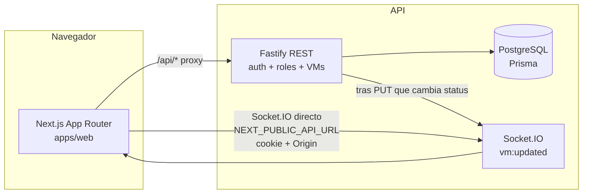
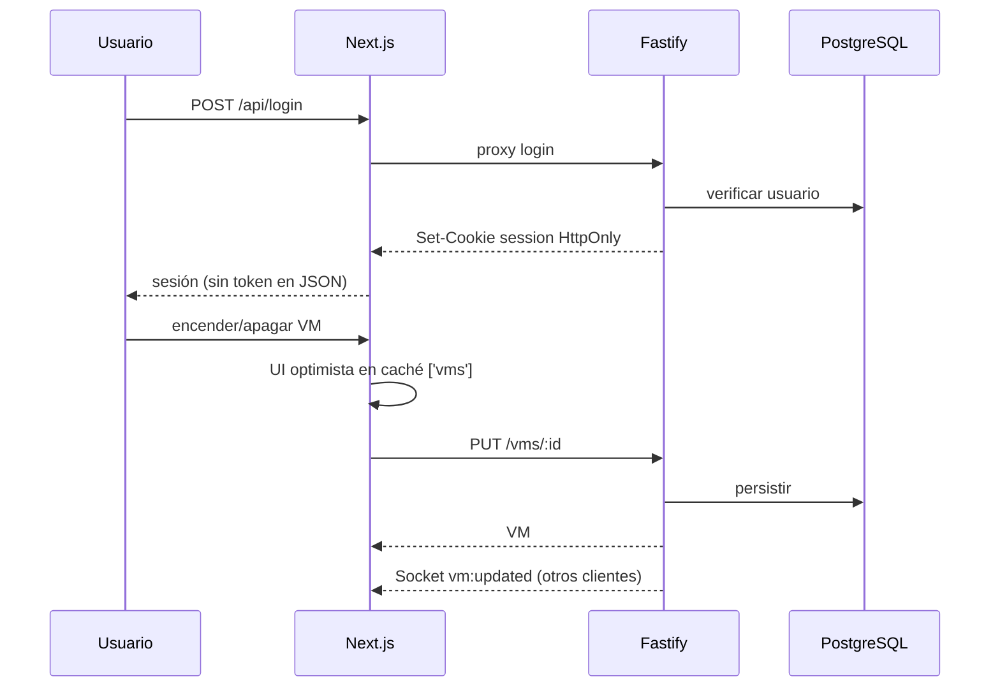

# IFX — VM Console

Prueba Full Stack **local** de gestión de máquinas virtuales: el frontend es el protagonista y la API aplica autenticación, roles y validación. Producto de demostración: **VM Console**.

Evaluación prevista en máquina local (sin despliegue en la nube).

## Requisitos previos

| Herramienta | Versión |
| --- | --- |
| Node.js | ≥ 20 (en esta entrega: 24.21.0) |
| pnpm | 10 (`packageManager`: `pnpm@10.26.2`) |
| Docker Desktop | con Compose (en esta entrega: 29.x) |

La ruta del clon puede contener espacios; los scripts usan rutas entre comillas.

pnpm 10 exige declarar paquetes con scripts de build nativos: el `package.json` raíz ya lista Prisma y esbuild en `pnpm.onlyBuiltDependencies`.

## Instalación limpia (desde cero)

### PowerShell (Windows)

```powershell
Copy-Item .env.example .env
pnpm install
pnpm db:up
# Esperar healthy: docker compose ps
pnpm db:migrate
pnpm db:seed
pnpm dev
```

### Bash / POSIX

```bash
cp .env.example .env
pnpm install
pnpm db:up
# wait until db is healthy: docker compose ps
pnpm db:migrate
pnpm db:seed
pnpm dev
```

Tras el arranque:

| Servicio | URL |
| --- | --- |
| Web | http://localhost:3000 |
| API directa | http://localhost:4000 |
| Salud vía proxy | http://localhost:3000/api/health |
| Socket.IO | `NEXT_PUBLIC_API_URL` (por defecto http://localhost:4000) |

Si el puerto `5432` está ocupado, cambia `POSTGRES_PORT` en `.env` y actualiza `DATABASE_URL` / `DATABASE_URL_TEST`.

El seed es **idempotente**: puede repetirse sin duplicar usuarios ni VMs.

## Variables de entorno

Copia `.env.example` → `.env`. Valores de desarrollo seguros (no secretos de producción):

| Variable | Uso |
| --- | --- |
| `DATABASE_URL` / `DATABASE_URL_TEST` | Prisma (dev y tests aislados) |
| `API_PORT` / `API_INTERNAL_URL` | API Fastify y proxy de Next |
| `WEB_ORIGIN` | Origen permitido (CORS / Origin / Socket.IO) |
| `NEXT_PUBLIC_API_URL` | Origen público de Socket.IO (conexión directa) |
| `JWT_SECRET` / `JWT_EXPIRES_IN` | Sesión JWT (cookie HttpOnly) |
| `SEED_*` | Credenciales del seed |

## Scripts

| Script | Acción |
| --- | --- |
| `pnpm dev` | Web (3000) + API (4000) en paralelo |
| `pnpm build` | Build de contratos, API y web |
| `pnpm typecheck` / `pnpm lint` / `pnpm test` | Calidad |
| `pnpm db:up` | PostgreSQL con Docker Compose |
| `pnpm db:generate` | Cliente Prisma (`postinstall` de `@repo/api` ya lo ejecuta) |
| `pnpm db:migrate` / `pnpm db:seed` | Migraciones (incluye generate) y datos demo |
| `pnpm db:reset` | Reinicia la base de desarrollo (**destructivo**) |
| `pnpm db:test:migrate` | Migraciones de `ifx_test` |

Colección HTTP de ejemplo: `apps/api/vms.http`.

## Credenciales de seed (solo local)

| Rol | Email | Contraseña |
| --- | --- | --- |
| Administrador | `admin@demo.local` | `AdminDemo!234` |
| Cliente | `cliente@demo.local` | `ClienteDemo!234` |

Entrar en http://localhost:3000/login.

## Recorrido de evaluación

### Administrador

1. Login → Panel: totales de vCPU / RAM / disco **solo de VMs `ON`** (sin % de utilización inventados).
2. Máquinas: listado, crear, editar, encender/apagar, eliminar (con confirmación).
3. Validación inmediata en el formulario; toasts y estados de carga/vacío/error.
4. UI optimista: el cambio se ve al instante y revierte si la API falla; alta fallida ofrece «Volver al formulario» con borrador en memoria.

### Cliente

1. Login → ve Panel y listado (todas las VMs).
2. Sin controles de escritura en la UI; `/vms/new` no es accesible como ADMIN.
3. `POST` / `PUT` / `DELETE` `/vms` con su cookie → `403`.

### Sesión y seguridad (comprobar)

- Recarga conserva la sesión; logout limpia cookie y redirige.
- Ruta privada sin sesión → `/login`.
- El JWT **no** viaja en el body de login ni en `localStorage`; cookie `session` con `HttpOnly`, `Secure`, `SameSite=Lax`, `Path=/`.
- En Chrome/Edge/Firefox actuales, `Secure` en `http://localhost` es aceptado (contexto seguro de localhost). No se desactiva `Secure` en silencio.
- Defensa de `Origin` en mutaciones; límite de intentos de login.

### Tiempo real (plus)

Dos sesiones (p. ej. ADMIN y CLIENT) en el dashboard: al cambiar el **estado** de una VM, la otra ve el cambio con resaltado e indicador «En vivo». Altas, bajas y ediciones sin cambio de `status` no se difunden por socket (se ven al reconsultar o al reconectar).

## Arquitectura

### Diagrama





### Decisiones (resumen)

Stack acordado: monorepo pnpm, Next.js + TanStack Query + RHF/Zod, Fastify + Prisma + PostgreSQL, contratos Zod compartidos, JWT en cookie HttpOnly. Detalle y registro: [`docs/DECISIONES.md`](docs/DECISIONES.md). Plan de fases: [`docs/PLAN.md`](docs/PLAN.md).

### Estructura del frontend (`apps/web/src`)

```text
app/                 # Rutas App Router (finas; layouts privados)
features/
  auth/              # Sesión, login, RoleGate
  vms/               # Listado, formularios, mutaciones, caché
  dashboard/         # KPIs y gráficos (derivados de ['vms'])
  realtime/          # Socket.IO, reconciliación, indicador
components/
  ui/                # Primitivas (Button, Input, …)
  layout/            # AppShell, Topbar, Sidebar
lib/                 # api-client, theme, utilidades
styles/              # Tokens y temas
```

**Estado global:** TanStack Query es la fuente de verdad del servidor (`['vms']`, `['session']`). No hay store de cliente adicional. Los borradores de formulario fallido viven en memoria (`VmDraftProvider`) y se pierden al recargar.

## Supuestos y reglas

- «Activas» / recursos del panel = VMs con `status === 'ON'`.
- Límites de validación: nombre 3–50 (letras Unicode, números, espacio, guion); vCPU 1–64; RAM 1–512 GB; disco 10–4096 GB.
- Nombres normalizados (NFC, espacios); unicidad por `nameKey` (sin distinguir mayúsculas).
- El Cliente **ve todas** las VMs; solo el Administrador escribe.
- En conflictos concurrentes gana la **última escritura** en el servidor.

## Limitaciones conocidas

- Tiempo real: **solo cambios de `status`**.
- Borrador tras alta/edición fallida: en memoria; una recarga completa lo pierde.
- Socket.IO usa conexión directa a la API (los rewrites de Next no proxifican el upgrade WebSocket).
- Publicación del repositorio remoto: **pendiente de decisión humana** (proveedor, visibilidad, nombre).

## Notas de seguridad

- Cookie de sesión siempre con `Secure` (objetivo del PDF); no se desactiva en local.
- Sin token en body de login ni en `localStorage`.
- Autorización en cada endpoint; la UI oculta acciones, pero el servidor es la autoridad.
- Rate limit en login; logs de API redactan cookies y contraseñas.
- `.env` no debe versionarse; usar solo `.env.example` con valores de desarrollo.

## Bitácora de IA

La [bitácora](docs/BITACORA_IA.md) resume el uso de asistentes, las decisiones humanas y el alcance de cada fase. Los resultados se respaldan con la evidencia registrada en `docs/phases/`.

### Herramientas usadas

| Herramienta | Uso |
| --- | --- |
| Claude Code (Claude Opus 5.5) | Planes de fase y consolidación documental |
| Cursor (Composer / Auto) | Implementación de las fases 01–09 |
| ui-ux-pro-max | Consulta de sistema de diseño y UX |
| impeccable | Contexto, detección y revisión visual |
| animate | Criterio de animación para cambios de estado |

### Delegación e intervención humana

- La IA apoyó los planes, el código, las pruebas, el diseño y la documentación.
- La persona responsable definió la arquitectura, acotó el alcance de las fases, corrigió discrepancias con el enunciado y mantuvo pendiente la publicación del repositorio.

### Ejemplos de instrucciones clave

Los siguientes textos están normalizados para lectura. Describen las instrucciones de trabajo sin reproducir mensajes personales de autorización.

Planificación de los módulos:

````text
Lee CLAUDE.md, docs/ENUNCIADO_PRUEBA.md, docs/DECISIONES.md y docs/PLAN.md. Crea los nueve planes en docs/phases con objetivo, dependencias, pasos, criterios de aceptación y verificaciones. No implementes código durante esta tarea. Al terminar, revisa la cobertura del enunciado y señala contradicciones o decisiones pendientes.
````

Inicio de infraestructura:

````text
Implementa únicamente la fase 01: monorepo pnpm, PostgreSQL con Docker Compose, migración y seed reproducible, contratos compartidos y esqueletos web/API. Comprueba el arranque local, la repetición del seed y la ruta de salud a través de la web. Registra los resultados reales y no avances a autenticación hasta cerrar la fase con evidencia.
````

## Estado de entrega

| Fase | Estado |
| --- | --- |
| 01 Infraestructura | Terminada |
| 02 Autenticación | Terminada |
| 03 API VMs | Terminada |
| 04 Shell y rutas | Terminada |
| 05 Listado y formularios | Terminada |
| 06 Dashboard | Terminada |
| 07 UI optimista | Terminada |
| 08 Tiempo real (plus) | Terminada |
| 09 Calidad y entrega | Terminada (local; remoto pendiente) |

**Repositorio remoto:** no publicado aún. Decidir proveedor, visibilidad y nombre antes de cualquier `push`.
